# zui

Native UI from HTML and CSS. The pictures are native windows from this tree.

Structure is HTML5. Layout and skin are CSS. C++ binds handlers and writes data.
The same page, rendered by zui, matches Chrome. There is no Chromium and no JavaScript.
Application code includes one header: `<zui/app.h>`.

## Software it already runs

Each heading is a program under [example/applications](./example/README.md). The name
in code is the CMake target. Run commands live in that program's README.

### [Reader](./example/applications/reader/README.md) `zui_reader`

小竹阅读. A shelf, the open page, and the chapter list. `.txt`, `.epub`, and `.pdf`.

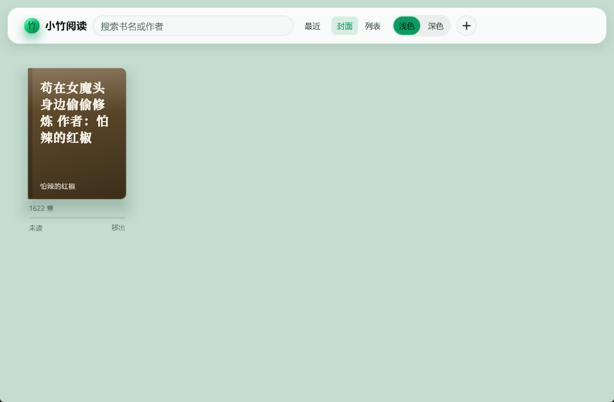
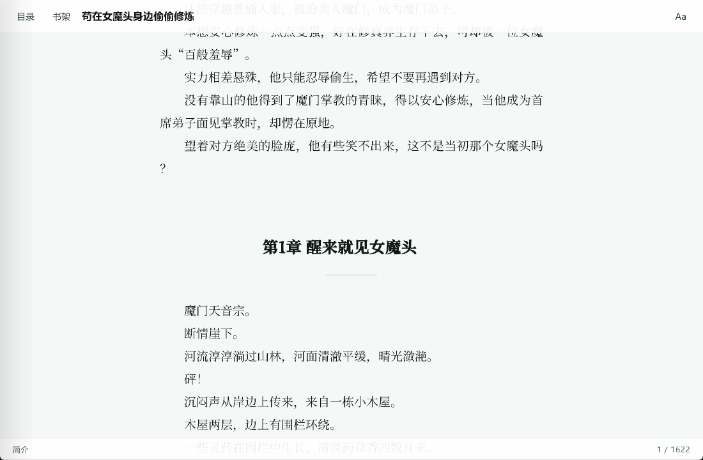
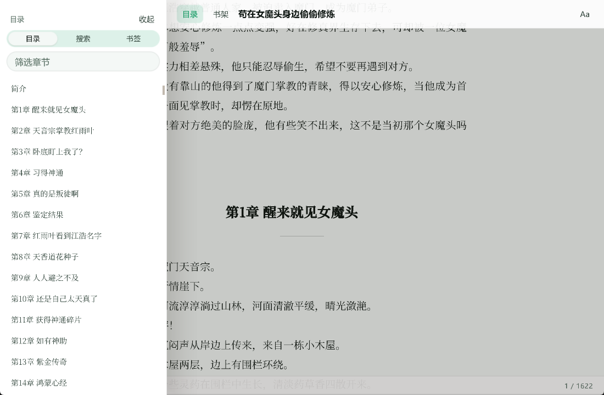

### [zmd](./example/applications/zmd/README.md) `zui_zmd`

小竹 Markdown. Preview of a document: headings, a list, a table, and the status bar.

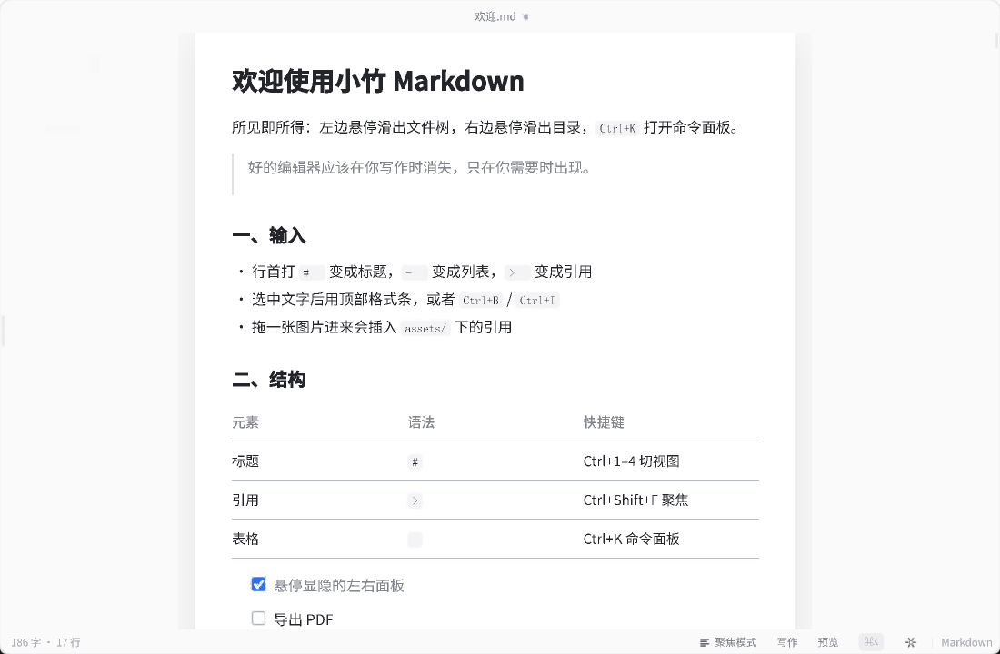

### [Album](./example/applications/album/README.md) `zui_album`

小竹相册. Albums on the left, a photo grid, and an opened photo.

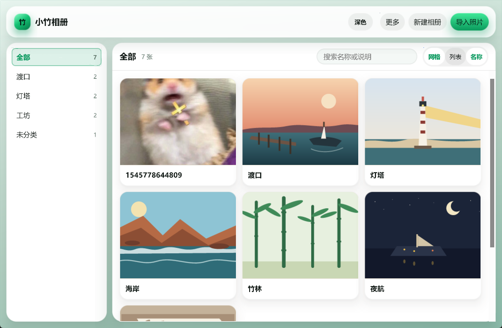


### [Calendar](./example/applications/calendar/README.md) `zui_calendar`

小竹月历. A month with the day's events, and the form that creates one.

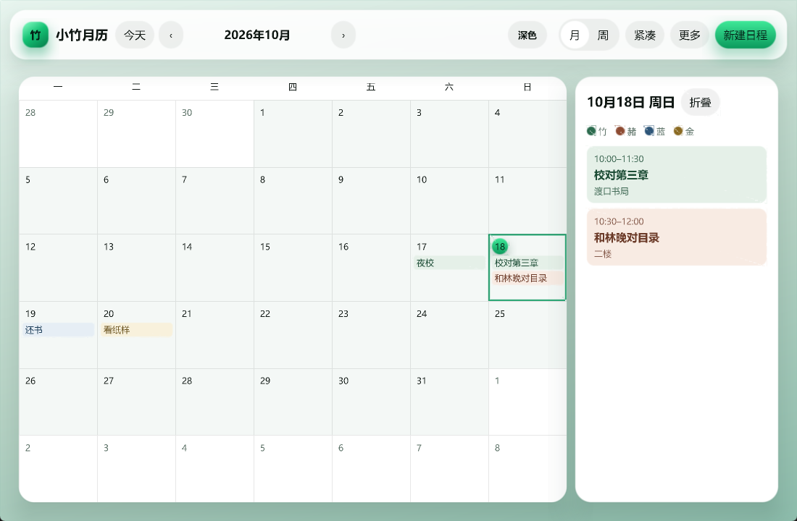
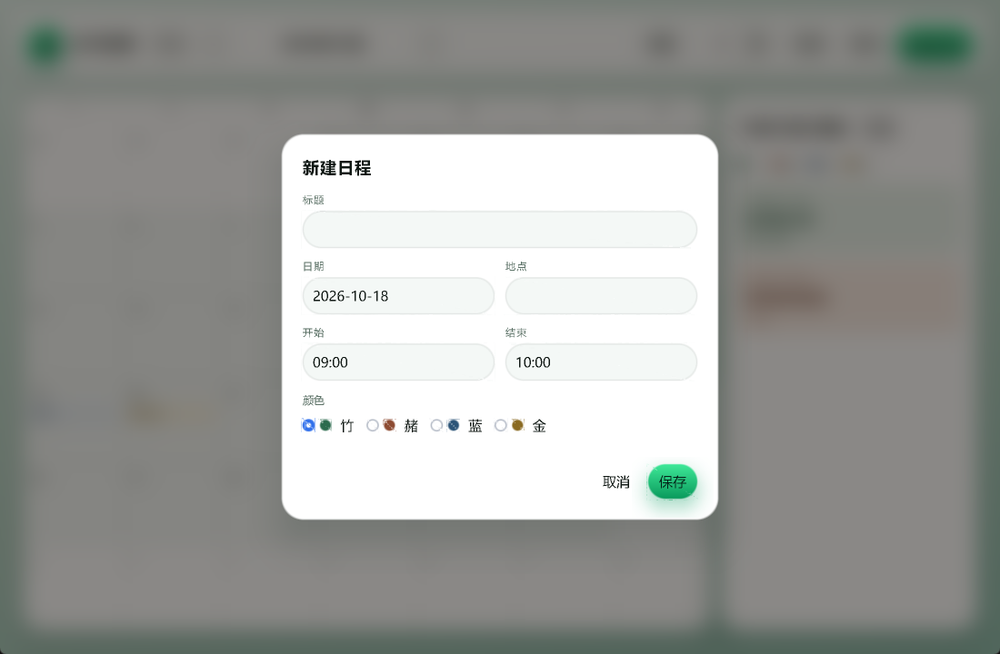

### [Kanban](./example/applications/kanban/README.md) `zui_kanban`

小竹看板. Columns of cards. Add a card at the bottom of a column.

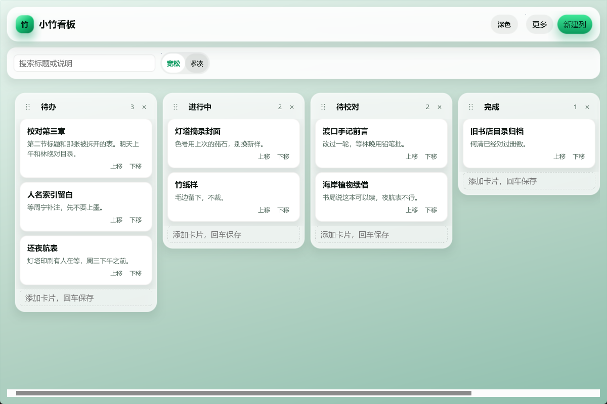

### [Chat](./example/applications/chat/README.md) `zui_chat`

小竹会话. Local threads and a transcript. No server.

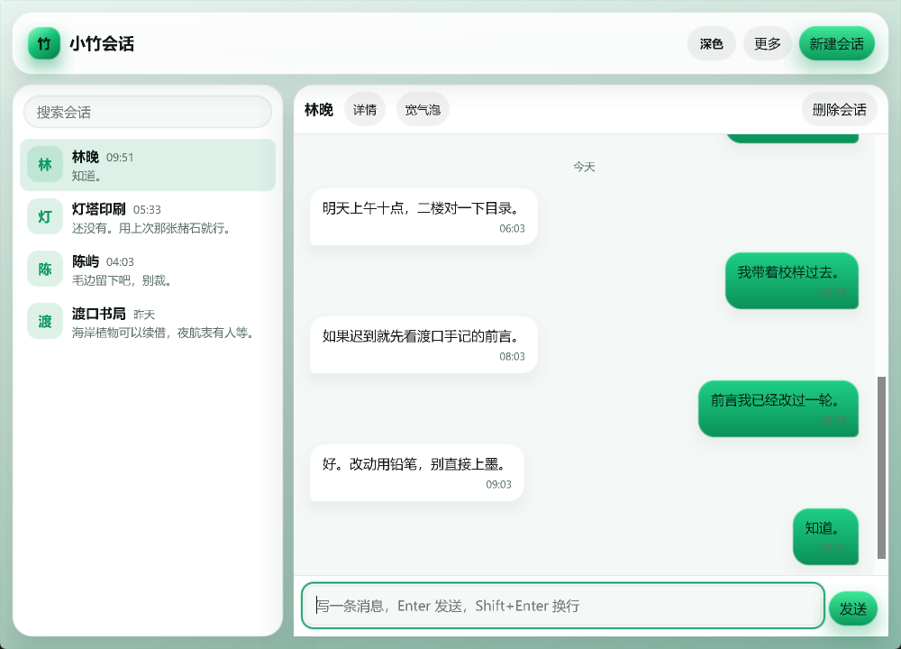

### [Contacts](./example/applications/contacts/README.md) `zui_contacts`

小竹通讯录. A filterable list, one person's card, and the edit form.

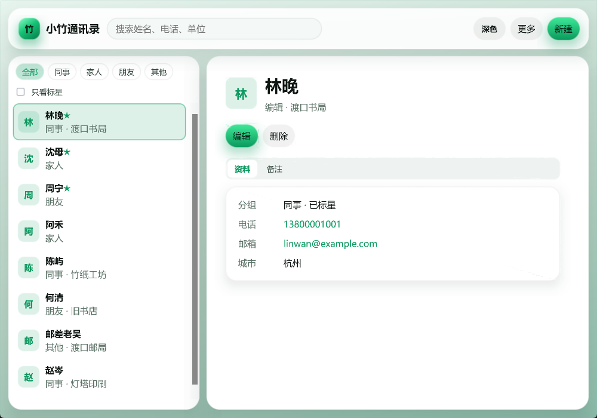
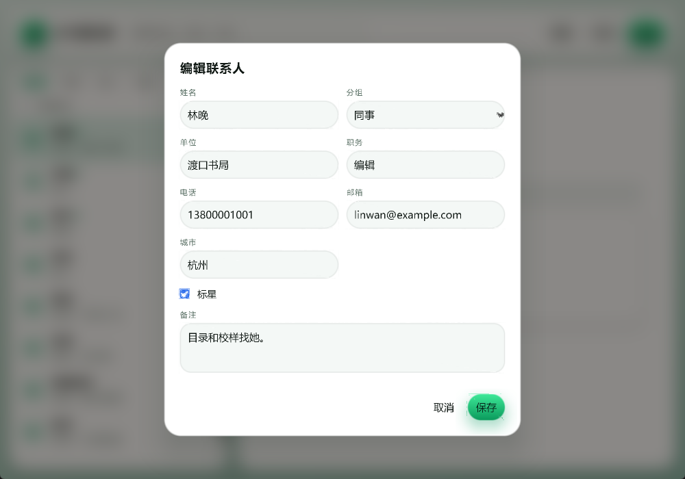

### No screenshot yet

| Program | What it does |
| --- | --- |
| [Writer](./example/applications/writer/README.md) `zui_writer` | Local notes. Document tree, outline, markdown markers in a textarea, and a reading view. |
| [zdb](./example/applications/zdb/README.md) `zui_zdb` | SQLite browser: open a file, browse tables, run SQL, export a copy. The example links SQLite. zui has no database API. |
| [Share](./example/applications/share/README.md) `zui_share` | Two machines on one network discover each other, send files, and resume. |
| [Particle](./example/applications/particle/README.md) `zui_particle` | A field of HTML dots on a timer, with parameters beside it. Shader files are text. zui does not run GLSL. |

[File explorer](./example/applications/file-explorer/README.md) is a browser page only. It has no native build.

## Smallest program

```html
<button id="save" class="primary" onclick="on_save">Save</button>
```

```cpp
#include <zui/app.h>

int main(int argc, char** argv) {
    zui::App app(argc, argv);
    app.document().load("window.html");
    app.document().bind("on_save", [&app](zui::Event&) {
        app.document().set("status", "text", "Saved");
    });
    return app.run();
}
```

## Build

Windows (clang-cl + Ninja, MSVC headers and import libraries):

```bash
cmake --preset windows-x64
cmake --build --preset windows-x64 --target zui_hello
build/windows-x64/zui_hello.exe
```

LLVM's `clang-cl` must be on `PATH`. The driver finds the MSVC toolchain and the Windows SDK.
`vcvars64.bat` is not required. Recreate an older `cl.exe` build directory once with
`cmake --preset windows-x64 --fresh`.

```bash
cmake --build --preset windows-x64
ctest --preset windows-x64 --output-on-failure
```

Switch backends with `ZUI_WINDOW=sdl3|glfw3` and `ZUI_RENDERER=vk|gl|gles`.

Vendored libraries live in `third_party/` and are wired by `cmake/deps.cmake`.

## How it is cut

```
HTML / CSS  →  Node tree  →  retained box tree  →  DisplayList  →  GPU
                 bind table      LayoutEngine         paint         IRenderer
```

Appearance changes go through `class`. Data goes through `set` / `set_model`. Interaction
goes through HTML event attributes and `bind`.

## Docs

`docs/` is for people who work on zui. It holds current engine mechanism and contributor
conventions. Application walkthroughs live next to the programs; start at
[example/README.md](./example/README.md).

| File | What it is |
| --- | --- |
| [AGENTS.md](./AGENTS.md) | Hard rules for every change |
| [docs/CONTRACT.md](./docs/CONTRACT.md) | Product surface |
| [docs/ARCHITECTURE.md](./docs/ARCHITECTURE.md) | Modules, one frame, backends, plugins |
| [docs/MARKUP.md](./docs/MARKUP.md) | HTML5 + CSS parse |
| [docs/LAYOUT.md](./docs/LAYOUT.md) | Layout engine |
| [docs/EVENT.md](./docs/EVENT.md) | Events, bind, models |
| [docs/PERF.md](./docs/PERF.md) | Cost invariants and tracing |
| [docs/TESTING.md](./docs/TESTING.md) | Chrome comparison and test seams |

## License

zui is licensed under either of

* Apache License, Version 2.0 ([LICENSE-APACHE](LICENSE-APACHE))
* MIT license ([LICENSE-MIT](LICENSE-MIT))

at your option.

Copyright (c) 2026 小竹.

Code under `third_party/` keeps the license shipped with that library.
